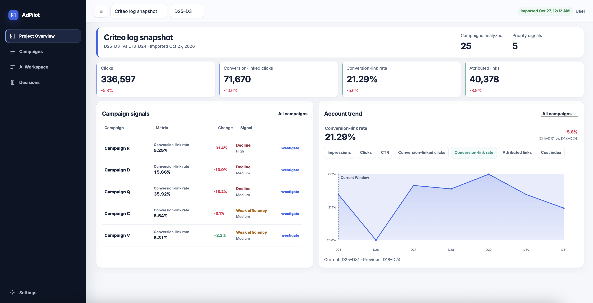
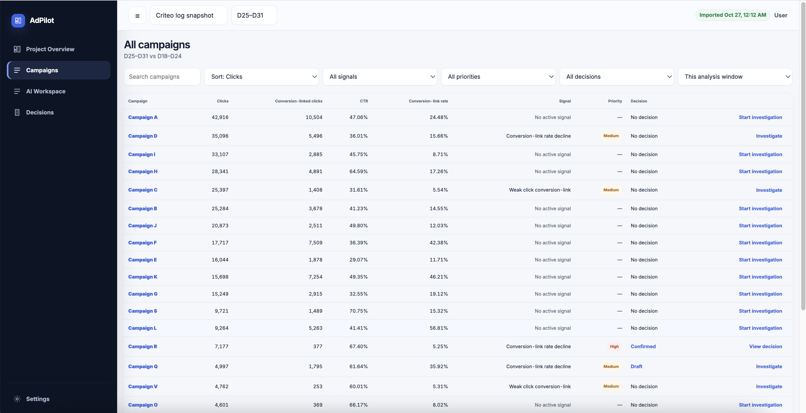
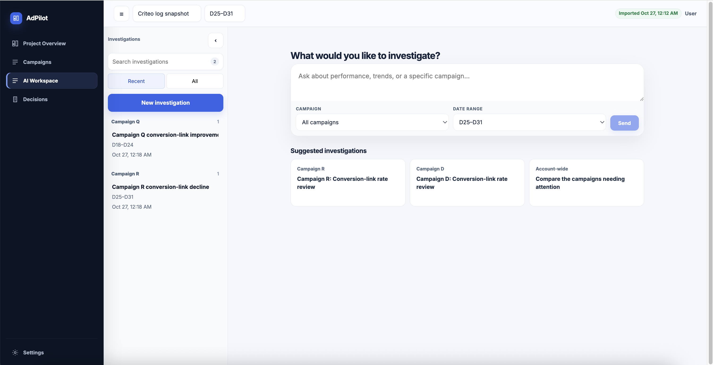
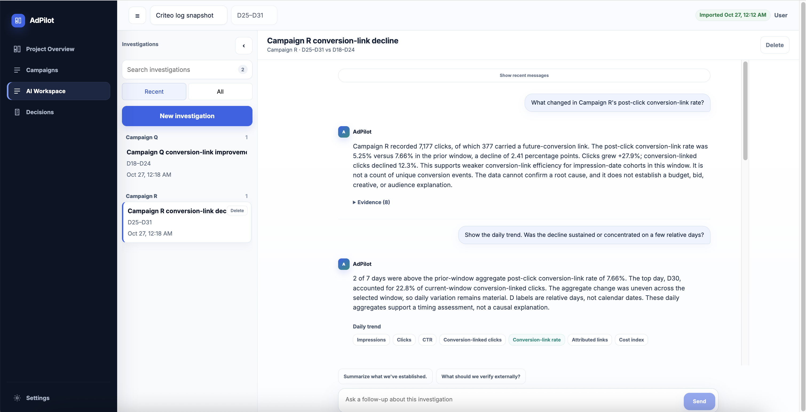
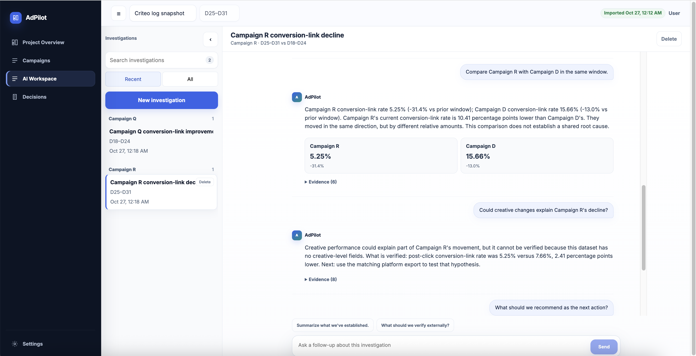
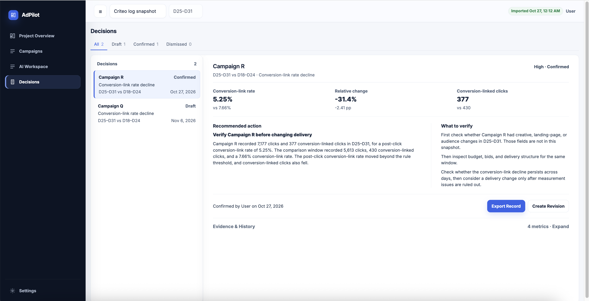
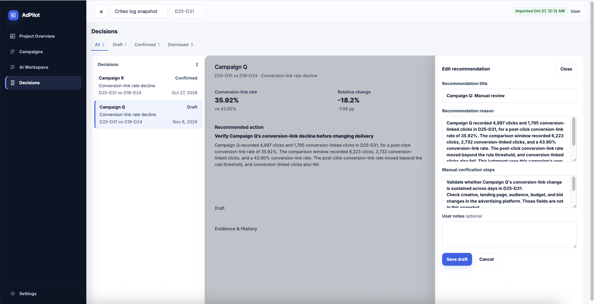
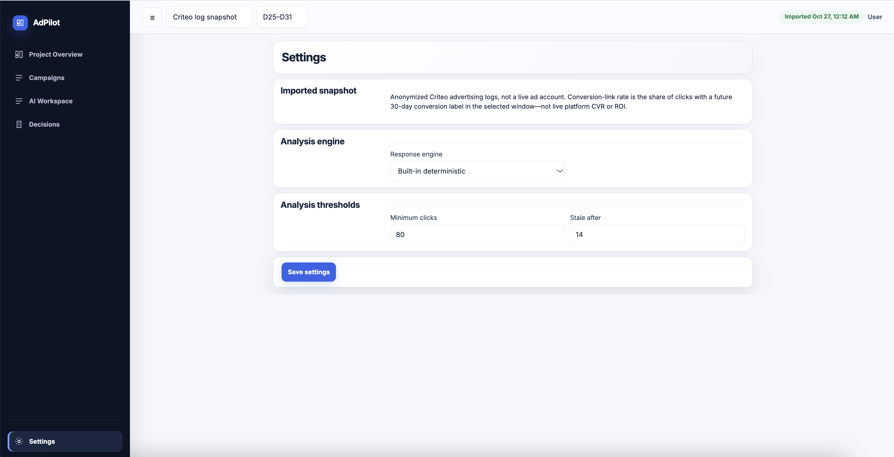

# AdPilot

AdPilot 从历史广告日志中调查异常，帮助用户做决策。

产品界面为英文，单用户模式。

<p>


</p>
<p>


</p>
<p>


</p>
<p>


</p>

## 能做什么

| 页面 | 作用 |
|------|------|
| Project Overview | 账户窗口指标与 campaign 异常信号 |
| Campaigns | 计划列表、信号、优先级、调查与决策入口 |
| AI Workspace | 多轮调查：窗口指标、日趋势、跨 campaign 比较 |
| Decisions | 查看、编辑、确认、驳回、导出复核建议 |
| Settings | 数据来源说明与分析引擎 |


## 数据口径

运行时使用 **Criteo Attribution Modeling for Bidding** 公开匿名日志，不是实时广告账户。

- 来源：<https://ailab.criteo.com/criteo-attribution-modeling-bidding-dataset/>
- 许可：[CC BY-NC-SA 4.0](https://creativecommons.org/licenses/by-nc-sa/4.0/)
- 原始文件：`data/pcb_dataset_final.tsv`（不入库）
- 预处理结果：`data/processed/`
- 会话与 Decision：`data/adpilot.db`

**Conversion-linked click**：本窗口内带有未来 30 天转化标签的点击，不是确认成交或收入。  
**Conversion-link rate**：上述点击 / 点击，不是 live CVR 或 ROI。  
**Cost index / CTR / impressions**：抽样日志指标，不是完整商业账户投放数据。`cat1`–`cat9` 为匿名特征，不作人群或品牌解释。

## 技术栈

- 前端：Next.js 14（`http://localhost:3011`）
- 后端：FastAPI（`http://127.0.0.1:8000`）
- 存储：SQLite

## 启动

```bash
npm install
python3 -m venv .venv && .venv/bin/pip install -r apps/api/requirements.txt
cp .env.example .env.local

# 首次或更新原始 TSV 后
npm run data:prepare

npm run dev
```

默认使用仓库根目录 `.venv`。也可以先 `source` 自己的虚拟环境，或设置 `ADPILOT_VENV`。

| 命令 | 说明 |
|------|------|
| `npm run dev` | 同时启动 Web 与 API |
| `npm run dev:web` | 仅前端 |
| `npm run dev:api` | 仅 API |
| `npm run build` | 构建前端 |
| `npm run typecheck` | TypeScript 检查 |
| `npm run test:final-qa` | 调查与 Decision 回归 |
| `npm run data:prepare` | 预处理 Criteo TSV |
| `npm run eval` | 评估，结果写入 `evaluation/results/` |

不要在 `npm run dev` 运行时对同一 `.next` 目录执行 `npm run build`。
